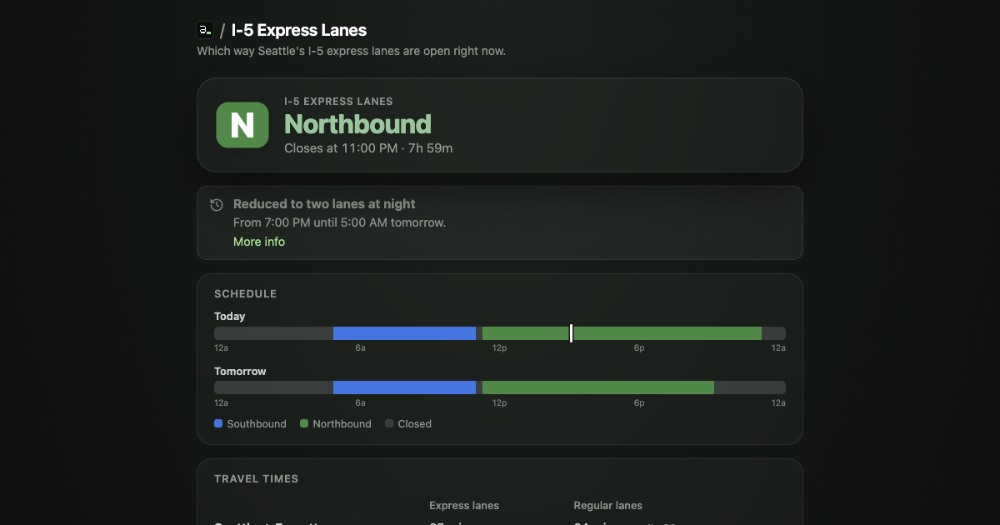
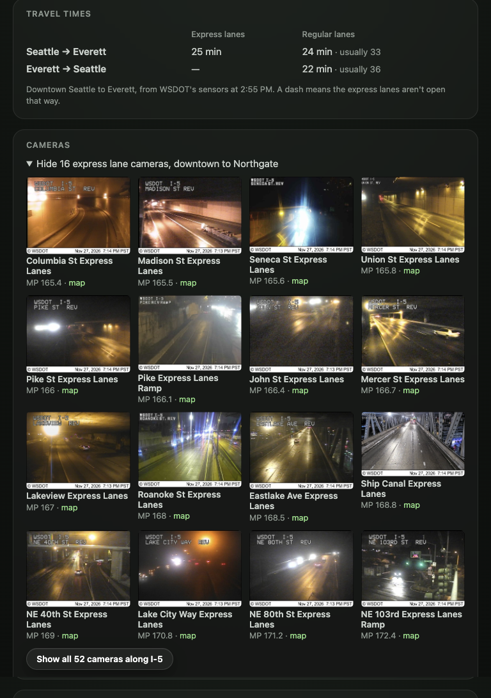

# I-5 Express for the Web

[](https://github.com/andrewmacheret/i5-client/actions/workflows/deploy.yml) [](https://github.com/andrewmacheret/i5-client/actions/workflows/canary.yml) [](https://github.com/andrewmacheret/i5-client/blob/main/LICENSE.md)

A web page that shows which way Seattle's I-5 express lanes are running right now, and whether they're open at all. It also serves a live badge that any site or README can show:

[](https://andrewmacheret.com/projects/i5/)

Live at [andrewmacheret.com/projects/i5](https://andrewmacheret.com/projects/i5/).

It's the web version of [i5-macos-menubar](https://github.com/andrewmacheret/i5-macos-menubar) and [i5-android](https://github.com/andrewmacheret/i5-android). The schedule comes from [i5-server-lambdas](https://github.com/andrewmacheret/i5-server-lambdas), which reads WSDOT's page and highway alerts with two AI models and works out the timeline. This page only draws it.



## Features

The page has the same sections as the Mac popover and the Android app screen:

- **Status:** green **N** for northbound, blue **S** for southbound, red **✕** for closed, and what happens next, like "Closes at 9:00 PM · 5h 24m". An amber dot on the icon means the lanes switch within 15 minutes.
- **Can't confirm:** an amber **⚠** replaces the direction whenever the status can't be trusted, with each reason and links to live sources. Its Traffic cameras link opens the Cameras section. See [When to trust it](#when-to-trust-it).
- **Notices:** closures and other notices in effect now or later today.
- **Timelines:** colored bars for today and tomorrow, with a marker for now.
- **Travel times:** downtown Seattle to Everett and back through the express lanes and on the regular lanes, from WSDOT's sensors, with the regular lanes' usual time.
- **Cameras:** WSDOT's camera pictures along the express lanes, closed until opened so nothing loads before that. The express lane cameras come first, and the rest of I-5 from downtown to Northgate is one tap away. Each picture links to the full image and to the travel map zoomed in on that camera, and has its own reload button. The browser loads the pictures straight from WSDOT and refreshes them every 5 minutes. A picture that doesn't load is tried 3 more times, after 5, 15 and 45 seconds. A link at the bottom opens every camera on WSDOT's travel map.
- **Coming up:** the next four changes with countdowns. A ⚠ marks days that may not follow the regular schedule.
- **Planned changes:** weekend closures, early closing dates, and holidays in the next two weeks, with how sure the times are and WSDOT's own words.
- **Regular schedule and sources:** the weekly schedule as WSDOT posts it, and links to every page and alert the data comes from.
- **Badge for your site:** builds the Markdown or HTML for the badge below.



Times are always Seattle time. If your browser uses another time zone, the page says so.

The page updates itself every 15 seconds and asks the server for new data every 5 minutes. It remembers the last copy it got, so it shows something right away and keeps working offline, until that copy is 2 hours old.

There are no notifications or home screen icon. Use the Mac or Android app for those.

To see the page at another moment, add `?now=` with a time, like [`?now=2026-11-26T10:00-08:00`](https://andrewmacheret.com/projects/i5/?now=2026-11-26T10:00-08:00) for Thanksgiving morning. It uses the server's current timeline, which covers about two weeks.

## Badge

Put this in a README or web page:

```markdown
[](https://andrewmacheret.com/projects/i5/)
```

The page's "Badge for your site" section builds it with other styles. The options are in [i5-server-lambdas](https://github.com/andrewmacheret/i5-server-lambdas#badge).

## When to trust it

WSDOT doesn't publish a live feed for the express lanes. The page shows **N**, **S** or **✕** only when the server read WSDOT recently, both models agree, nothing about now is unclear, and WSDOT's travel time sensors don't show traffic going the other way. Otherwise it shows an amber **⚠**, explains why, and links to live sources. The full list is in [i5-server-lambdas](https://github.com/andrewmacheret/i5-server-lambdas#doubts).

It can't know about a closure WSDOT hasn't posted yet, like an emergency repair announced only on social media.

## How it works

- `src/web` is the page (React and Vite), deployed to `s3://andrewmacheret.com/projects/i5`. It fetches `GET https://i5.andrewmacheret.com/status` and draws it.
- `src/core` is copied from [i5-server-lambdas](https://github.com/andrewmacheret/i5-server-lambdas)' `src/core`. It turns the server's timeline into what the page shows at any moment (`snapshot.ts`, `trust.ts`), and draws the icon. Copy changes there to here.

Tests render the page from real `/status` responses in `test/fixtures`, made by the server's code from saved copies of WSDOT's page: a normal day, a holiday, a new notice being read, a failed reading, WSDOT being down, the 2022 winter storm and Revive I-5's months of northbound.

## Development

You need Node.js 24 or later.

| Command | What it does |
| --- | --- |
| `npm install` | Install the dependencies |
| `npm test` | Run the page tests |
| `npm run typecheck` | Check the TypeScript types |
| `npm run dev` | Run the page on [localhost:5173](http://localhost:5173), using an API on localhost:8787. Start one with `npm run api` in [i5-server-lambdas](https://github.com/andrewmacheret/i5-server-lambdas). For screenshots, start it with `-- --at 2026-12-01T15:00-08:00` and open the page with the same `?now=`. |
| `npm run build` | Build the page into `dist/` |

Add `?api=` to the page's address to use another copy of the API, like `?api=https://i5.andrewmacheret.com` to run the local page against the real one.

## Health check

Once a day, the Canary workflow (`.github/workflows/canary.yml`) checks the page and its scripts and styles, the README badge, and the API's own health check, which fails if the 15 minute refresh stopped, can't read WSDOT, or no model could read its latest notice. It also loads four express lane camera pictures from WSDOT (half have to load, since single cameras go down now and then), and checks that WSDOT Traffic still posts on Bluesky. WSDOT's map answers every address with its app, even ones that don't exist, so a broken map link can't be told apart from a working one. It's started by [andrewmacheret/canary](https://github.com/andrewmacheret/canary).

## Deploy

Pushes to `main` run the tests, then GitHub Actions ([`deploy.yml`](.github/workflows/deploy.yml)) uploads the page and clears the CloudFront cache. To redeploy without a code change, use "Run workflow" on the Actions tab.

The workflow signs in to AWS with GitHub OIDC, using the IAM role `GitHubDeployI5Client` in the `AWS_ROLE_ARN` repo variable. It can only write `projects/i5/` in the website bucket and invalidate the CloudFront distribution.

## Built with LLM tools

This project was written with LLM coding tools: an AI agent in [Cursor](https://cursor.com) wrote the code, tests and this README, directed by a human. Treat it like any other code from the internet and read it before you rely on it.

## Not affiliated with WSDOT

This is a personal project. Schedule data comes from the Washington State Department of Transportation. Always follow posted signs on the road.

## License

[MIT](LICENSE.md)
